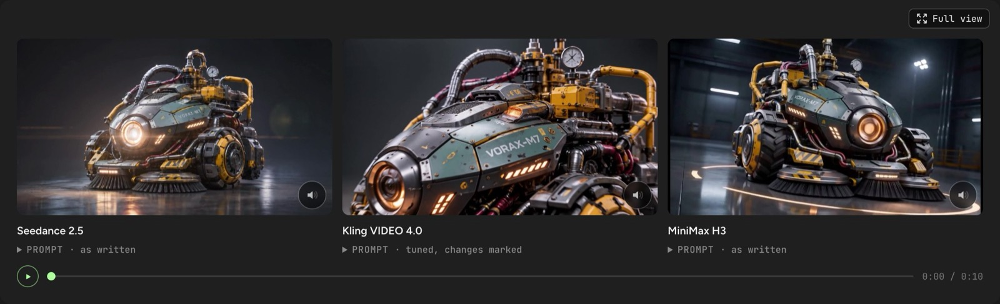

# Model Arena

**One brief, several video models, side by side on one clock.**

[](https://runware-arena.pages.dev/)

Model Arena is a drop-in web component that plays video-model outputs side by side on one clock, runs them with your own key, and shows exactly what each model was given and what it cost. See it in use in the post [Three briefs, four video models](https://runware-arena.pages.dev/): Seedance 2.5, Kling VIDEO 4.0, MiniMax H3 and FLUX 3 Video on the same briefs, with each prompt, the measured cost and time, and what each model did well and where it fell short.

**Runs on [Runware](https://runware.ai).** Lanes go through the Runware API with your own key: Kling VIDEO 4.0, Seedance 2.5, MiniMax H3, LTX-2.5 and FLUX 3 Video for video, and nine image models for character stills. A dry run prints exactly what would be sent. A paid run needs a price cap and a typed yes, and logs what it cost. The key goes only to `api.runware.ai` and is never logged or written to a record.

## What it does

- **One clock.** `<model-arena>` plays every model's clip in step, in four layouts, with the prompt and inputs each model received under its tile.
- **What each model takes.** `<model-specs>` is a spec matrix read from Runware's schemas: inputs, limits, prices, how you prompt each model and how you move its camera.
- **One brief, a prompt per model.** The composer turns one neutral shot description into each model's own prompt and request parameters.
- **Embeds anywhere.** One ES module for a page, and an embed bundle with a key panel, the generate flow and a gallery for another app.

## Quick start

Node 24 and ffmpeg (for the placeholder clips). Nothing here sends a request or needs a key.

```sh
git clone https://github.com/koshimazaki/model-arena && cd model-arena
nvm use 24 && npm install
npm run demo:placeholders   # labelled placeholder clips and stills (gitignored)
npm run dev                 # Vite on http://localhost:5173
```

Open **http://localhost:5173/specs.html** for the spec matrix and the composer, and **http://localhost:5173/blog-demo.html** for the layouts playing placeholder clips on one clock.

## Embed

```html
<script type="module" src="model-arena.js"></script>
<model-arena src="records/mannequin-five-models.json" layout="three-up"></model-arena>
<model-specs models="kling-4,seedance-2.5,h3,ltx-2.5,flux-3-video"></model-specs>
```

`npm run build` writes the elements as one file, `dist/model-arena.js`.

## Docs

| | |
| --- | --- |
| [The elements](docs/elements.md) | attributes, the four layouts, media paths and theming |
| [Embedding in another app](docs/embed.md) | the key panel, the generate flow, the player and the gallery |
| [The command line](docs/cli.md) | dry runs, paid lanes and character stills, the price cap, your key |
| [Model specs](docs/model-specs.md) | the spec format and how to add a model |
| [Runware provider](docs/providers/runware-api.md) | inputs, prices, camera parameters, character stills |
| [The published post](docs/deploy.md) | how the post reaches Cloudflare Pages and R2, and how to add a clip |
| [Developing](docs/developing.md) | a map of the repo, the checks, demo media and records |
| [Costs](docs/costs.md) · [Friction log](docs/friction.md) | every paid run, and what got in the way on the platform |
| [Product requirements](docs/PRD.md) · [Plan](docs/plan.md) | what it is for and how it was built |

Companion repo: [Draw Control](https://github.com/koshimazaki/draw-control) makes the guide clips. Model Arena reads its guide bundles; the two share files, not code.

## Licence

MIT ([LICENSE](LICENSE)).
